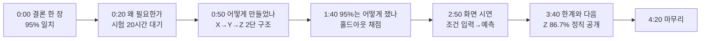

# 42. 임원 보고용 시연 영상 — "95% 일치율은 어떻게 만들어졌나" (2026-10-15)

## 배경

- 기존 최종본(`제출물_영상/창원품질경영팀_김경준 주임_AI 포화도 예측.mp4`, 78.6초, 무음)은 기능 나열형이라 임원 설명용으로 약하다.
- 심사에서 "일치율 95%"로 높은 평가를 받았고, 임원은 그 수치가 어떻게 설계·검증됐는지를 궁금해할 것이다.

## 95%의 정확한 정의 (확인한 사실)

- **측정 대상**: 시험 완료 로트에서 "AI가 예측한 SPEC 합격/불합격"이 "실제 시험 결과"와 같은지의 비율(`backend/analysis/scoring.py`).
- **Y(포화도) 95.0% = 60건 중 57건 일치**, 3건 불일치. 학습(240건)에 쓰지 않은 검증 표본 60건만으로 채점(홀드아웃 80/20, 고정 시드).
- 같은 조건의 나머지 타깃(더미 4,992행·시험 300건, 2026-10-15 재현): Z 86.7%(52/60, 90% 미달), EN CCA 90.0%(27/30), SAE CCA 93.3%(28/30).
- 신뢰 가능 기준은 일치율 90% 이상(사용자 확정).
- **주의**: 위 수치는 더미 데이터 기준이며 실데이터 검증이 아니다. 영상·발표에서 "더미 기준"을 명시한다. 표본 60건이라 신뢰구간이 넓다는 점도 한계로 밝힌다.

## 영상 구성(약 4분 30초, 결론 먼저)

| 구간 | 내용 | 화면 |
|---|---|---|
| 0:00 | "시험 전에 합격 여부를 95% 맞힌다" 결론 카드 | 타이틀+핵심 숫자 |
| 0:20 | 문제: Z는 20시간 시험 후에야 앎 → 불량을 늦게 발견 | 도식 |
| 0:50 | 설계: 공정 조건(X) → 포화도(Y) → 20시간 용량(Z), 충전 프로그램 이탈도 반영, 다중공선성(VIF) 점검 | 도식+대시보드 근거 |
| 1:40 | 검증: 240건으로 학습, 안 본 60건으로 채점, 57건 일치 | 채점 카드 애니메이션 |
| 2:50 | 시연: 업로드→분석→조건 변경 예측→원인 인자 | 실제 화면 녹화 |
| 3:40 | 한계: Z 86.7%·표본 60건·더미 데이터, 개선 계획 | 표 |
| 4:20 | 요약 한 줄 | 마무리 카드 |

## 제작 방법·제약

- 녹화는 로컬 서버(같은 코드·더미 데이터)로 한다(Render 무료 서버는 느리고 DB가 비어 있음). 하단 태그는 "더미 데이터 기준".
- 음성: ElevenLabs 키가 있으면 `tts.py`로 합성, 없으면 자막본으로 먼저 완성하고 키 확보 시 음성 추가.
- 완료 기준: 5분 이내, 영상 속 모든 숫자가 위 실측값과 일치, 컷 시트로 장면별 확인, srt·대본 저장.

## 변경 (2026-10-15 오후) — 영상 분량 축소, 발표 병행

- 발표 5분 = 슬라이드 1장 + 영상 전체 기준임이 확인됨. 영상은 **약 2분 20초**로 줄이고, 발표자가 직접 말하는 구간(오프닝·왜 필요한가·부족한 점·앞으로의 변화)은 영상에서 제외.
- 영상 포함: 3장(설계)·4장(95% 측정)·5장(화면 시연). 나레이션 음성은 Sarah(ElevenLabs)로 합성 완료(`제출물_영상/음성_본편/3~5.mp3`, 합계 128.3초). BGM은 사용자가 고른 파일을 나레이션 아래에 낮춰 깔기.
- 시간 배분: 직접 20초 + 직접 30초 + 영상 140초 + 직접 40초 + 직접 55초 = 약 4분 45초.
- 발표 대본 PPT: `제출물_영상/임원보고_발표대본.pptx`(11쪽, sebang-deck, 렌더 확인).

## 변경 (2026-10-16) — 도입 1초 연장, 마무리 카드 교체
- 타이틀 카드 3.8초 → 4.8초(읽기 어렵다는 피드백).
- 마지막 "처음 보는 60건 중 57건을 맞혔습니다" 카드는 4장에서 이미 같은 수치를 보여 주고 직접 발표가 이어지므로 중복이라 삭제. 대신 "얻는 것 3가지 / 더 좋아질 점 3가지" 정리 장면(나레이션 13.6초)으로 교체. 더미 데이터 기준·BGM 출처는 이 장면 하단 한 줄로 이동.
- 영상 약 2분 22초, 발표 합계 약 4분 47초.

## 변경 (2026-10-16 오후) — "업로드만 하면 사람 작업 없이 자동" 관점으로 재정렬
- 배경: 포화도는 감액량으로 바로 확인되는 값이므로, 가치는 "예측 정확도"만이 아니라 "데이터를 올리면 사람의 계산·대조 없이 포화도 예측 → 제품 성능(20시간 용량·저온 시동 성능) 확인이 자동으로 이어진다"는 점. 임원 티타임 자료 4쪽 과제 배경(A안)·구현 내용, 영상 3장(설계)·마무리 요약, 대본 3·7장에 반영.
- 영상은 3장·마무리 나레이션 재합성(ElevenLabs), 3장 인포그래픽·타이틀 부제·요약 카드 문구 수정 후 재렌더(`하이브리드_최종후보_v5.mp4`). 5장(실제 시연) 녹화는 그대로 재사용.

## 변경 (2026-10-21) — 실제 구현 화면 30초 추가, 5분 맞춤 (v6)
- 요청: 기능 설명이 적으니 실제 구현 화면을 약 30초 더 보여주고, 중요한 기능을 그 안에 포함. 발표 대본은 간략하게 줄여 5분 이내로 맞춤.
- 추가 구간(5장 화면 시연과 6장 사이): ① 업로드 미리보기(저장 전 확인) ② 분석 실행 한 번 → 종합 결론·검증 신뢰도(채점) ③ 상세 분석: 형명별 + 규격 미달 로트의 원인 조건 ④ 저온 시동 성능 합불 판정. 출처는 `제출물_영상/전기능_나레이션_대본.md`의 기능 목록.
- 제작: 스크래치 폴더가 정리되어 기존 렌더 스크립트가 사라졌으므로, v5 영상은 그대로 두고 새 구간만 로컬 앱(더미 데이터)을 녹화해 v5의 5장·6장 사이에 삽입(오디오 크로스페이드, BGM 덕킹 동일 규칙). 결과 `하이브리드_최종후보_v6.mp4`.
- 시간: 영상 약 3분, 직접 발표는 약 1분 30초로 줄여 합계 4분 30초 안팎.
- 결과(2026-10-21): `하이브리드_최종후보_v6.mp4` 2분 58.7초(v5 + 5-2장 31초, 5장 뒤 1:52 지점 삽입). 대본 PPT 14쪽(5-2장 추가, 직접 발표 4구간 약 85초로 축소, 합계 약 4분 30초). 나레이션 ElevenLabs 171자 추가 사용. 직접 발표 합계는 말 속도에 따라 ±.
- 변경(2026-10-21 저녁): 3장 마무리 멘트(중복 점검 설명)와 해당 카드 삭제 → `하이브리드_최종_v7.mp4` 2분 48초(최종본). 대본·PPT 반영, 합계 약 4분 15초. 이전 후보 영상·음성·대본은 정리해 최신본만 보존.
- 변경(2026-10-21 밤): 화면·설명 1:1 동기화로 영상 재제작 → `하이브리드_최종_v8.mp4`(2분 42초, 최종본). 나레이션을 문자 단위 타임스탬프 방식으로 재합성해 문장 시작 시각에 화면 변화를 맞춤, 앱 녹화는 문장별 구간으로 나눠 재배치(확대·축소 효과 제거, 화면 125% 고정). 3장 '2단계로 나눈 이유' 멘트와 도식 문구 삭제, 5-2장 첫 문장을 '추가로 기능을 소개해 드리겠습니다'로 변경. 제작 소스는 `제출물_영상/제작소스/`에 보존. 합계 약 4분 10초.

## v9 변경 (2026-10-21)
- 대본에서 말하지만 화면에 안 잡히던 3곳을 다시 녹화해 보강: 5장 마지막 문장(원인 인자 목록), 5-2장 신뢰도 카드(86.7%), 5-2장 원인 조건 3가지 펼침. 6장 앱 화면은 3동작으로 분리.
- 대본 8·9장(부족한 점·앞으로의 변화)을 "8. 부족한 점과 앞으로의 변화" 한 챕터(약 25초)로 통합. 직접 발표 합계 85초→65초, 전체 약 3분 50초.
- 영상 파일: 제출물_영상/하이브리드_최종_v9.mp4 (v8 대체)
- (추가) 영상 마무리의 "더 좋아질 점" 카드·멘트 삭제 → 영상 2분 37초, 전체 약 3분 45초
